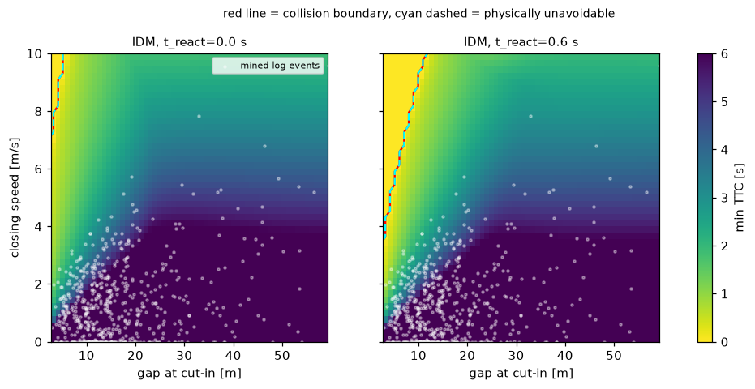
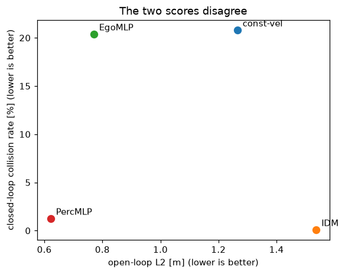

# REPORT — Lab Day 12

> Điền **bằng lời và số liệu của chính bạn** (lấy từ màn hình và từ `evidence/*.json`). Mỗi câu 4–8 dòng là đủ. Số không có trong bằng chứng của bạn sẽ bị trừ điểm. Báo cáo công khai trên GitHub; giảng viên đối chiếu với `evidence/` và với bài của các bạn khác.

| | |
|---|---|
| Họ và tên | Văn Thành Huy |
| MSSV (đúng bằng `--student-id` bạn đã chạy) | `2A202602763` |
| GitHub | [thanhhuyvan](https://github.com/thanhhuyvan/K4-Track4-VanThanhHuy-2A202602763-Replay-CloseOpenLoop) |
| Seed chia dữ liệu / seed mô hình (xem `evidence/closedloop.json`, mục `student`) | split=6911; model=6377, 6378, 6379, 6380, 6381 |
| Số seed huấn luyện bạn dùng (`--seeds`) | 5 (đã train EgoMLP và PercMLP, seed 6377–6381) |

## Kết quả cuối

Điền từ `evidence/closedloop.json`, `openloop.json`, `gate.json` (cho mỗi mô hình học, lấy **dải qua các seed**).

| Bộ điều khiển | L2 vòng hở (m) | Va chạm vòng kín trên log (%) | Quyết định cổng |
|---|---|---|---|
| constant-velocity | 1.2647 | 20.812 | BLOCK |
| IDM | 1.5365 | 0.104 | (baseline) |
| EgoMLP | 0.7671–0.7783 | 10.891–26.639 | BLOCK |
| PercMLP | 0.6157–0.6278 | 0.659–2.255 | BLOCK |
| PercMLP+ (sau khi sửa) | 0.7914–0.8237 | 0.208–0.382 | RELEASE (7/7 quy tắc lab) |

## Câu 1 · Dữ liệu
Bước 0 bạn phát hiện những vấn đề gì ở dữ liệu? Vì sao không dùng cột `Acc_LV`, và bạn thay bằng gì? Bao nhiêu quỹ đạo bị loại vì trùng, và vì sao chia theo quỹ đạo?

`evidence/data_audit.json`: 992.679 dòng, 9.993 quỹ đạo thô; loại 383 quỹ đạo trùng hệt, còn 9.610. Quỹ đạo trùng có thể mang ID xa nhau: chia trước loại trùng sẽ làm cùng dữ liệu xuất hiện cả train và test. Chia theo quỹ đạo sau dedupe, không theo frame vì các frame kề nhau có tính tương quan mạnh.

Tương quan Acc_LV với d(Speed_LV)/dt chỉ 0,04535, trong khi cột gia tốc xe theo sau có tương quan 0,92909. Vì vậy không dùng Acc_LV để tìm ca phanh: dùng a_lead từ Speed_LV làm mượt moving average 5 frame rồi đạo hàm trung tâm với dt=0,1 s. Quan hệ Pos_LV−Pos_FAV−Spatial_Gap có offset 4,5 m (chiều dài xe), không coi Spatial_Gap là khoảng cách tâm xe. Dữ liệu cũng chỉ phủ trạng thái con người đã lái, không bảo đảm phủ miền kịch bản khó.

## Câu 2 · Phát lại
Bản refactor float32 khác bit ở bao nhiêu đoạn, vượt dung sai ở bao nhiêu? Thay đổi AEB làm lệch bao nhiêu đoạn, và vì sao lệch ở đúng những khung đó (mở một đoạn ra xem)? Phát theo thời gian thật làm lộ ra điều gì mà phát nhanh nhất che đi?

Bằng chứng: `evidence/replay.json`. Chạy lại 600 đoạn cho kết quả giống hệt; refactor float32 khác giá trị chính xác ở 600/600 đoạn nhưng **0 đoạn vượt dung sai** atol=rtol=0,001; sai lệch lớn nhất 0,00040313 m/s². Vì vậy khác số thực không tự động đồng nghĩa đổi hành vi.

AEB làm 7/600 đoạn vượt dung sai (79, 84, 176, 232, 237, 351, 564). Kiểm tra đoạn 79 trong `evidence/replay_aeb_example.json`: frame 75–77 có TTC lần lượt 1,4751; 1,4622; 1,4357 s, đều dưới ngưỡng 1,5 s khi xe đang tiến gần xe trước. Lệnh IDM khoảng −4,38 đến −4,35 m/s² chuyển thành phanh AEB −6 m/s²: đây là thay đổi hành vi có nguyên nhân cụ thể.

Fastest xử lý 59.665 frame, không trễ hoặc rơi frame và không lệch. Với độ trễ xử lý **mô phỏng** trong chế độ realtime, có 582 frame trễ, 574 frame rơi; 377/600 đoạn vượt dung sai, sai lệch tối đa 13,3768 m/s². Replay nhanh nhất che khuất tác động deadline và đầu vào cũ; các số này không phải benchmark độ trễ thực của máy local.

## Câu 3 · Kịch bản
Lưới của bạn (tốc độ cruise, giới hạn khoảng cách, số ô): bao nhiêu % ô **không ai tránh được**? Độ trễ phản ứng 0 → 0,6 s làm vùng đâm của IDM tăng bao nhiêu? Log có phủ vùng khó không? (dẫn giới hạn phanh mạnh nhất của người lái trong log, và phần lưới đòi hỏi hơn thế)

Bằng chứng: `evidence/scenarios.json`. Cruise 10 m/s, gap 2,7601–59,3123 m, closing speed 0–10 m/s, lưới 60 × 45 = **2.700 ô**. Tỷ lệ không tránh được theo mô hình phanh là **0,9630%** khi phản ứng tức thời và **5,1481%** khi trễ 0,6 s. Kiểm tra full-brake so với biên vật lý có 0 ô bất đồng ngoài vùng sát biên được loại khỏi phép kiểm tra.

Vùng va chạm IDM tăng từ 0,9630% lên 5,1481%, tức **4,1852 điểm phần trăm** (26 → 139 ô). Phần va chạm có thể quy trách nhiệm cho IDM bằng 0 ở cả hai độ trễ, nhưng kết luận chỉ áp dụng trên lưới và mô hình 1D này. Constant-velocity đâm trên 73,3704% ô.

Log khai thác được **614 ca phanh / 9.610 quỹ đạo (6,3892%)**, tập trung nhiều ở closing speed nhỏ; vùng khó chưa được phủ đều. Ngưỡng phanh người lái do script dùng là **3,6248 m/s²**, phân vị 99,9% độ lớn gia tốc âm, không phải giá trị cực đại tuyệt đối. Có **5,2222%** ô yêu cầu phanh mạnh hơn ngưỡng đó; số ca phanh và số ô đạt mức coverage tối thiểu R7, chưa chứng minh phủ đủ thế giới thật.

## Câu 4 · Vòng hở và vòng kín
Dán bảng L2 và tỷ lệ va chạm của bốn bộ điều khiển (kèm hạng ở mỗi cách chấm). Cặp nào đổi thứ tự? Vì sao IDM có L2 như vậy mà vẫn lái tốt? Vì sao EgoMLP có L2 tốt hơn constant-velocity mà vẫn đâm?

Bằng chứng: `evidence/openloop.json` và `evidence/closedloop.json`; train 167.376 cửa sổ, test 71.757 cửa sổ từ 2.883 quỹ đạo held-out. L2 là trung bình sai số vị trí tại 1/2/3 s. Bảng dưới dùng **trung bình qua seed để xếp hạng**; bảng kết quả đầu báo cáo giữ dải min–max, và gate sau này dùng seed xấu nhất.

| Bộ điều khiển | L2 trung bình (m) | Hạng vòng hở | Va chạm trung bình (%) | Hạng vòng kín |
|---|---:|---:|---:|---:|
| const-vel | 1.2647 | 3 | 20.812 | 4 |
| IDM | 1.5365 | 4 | 0.104 | 1 |
| EgoMLP | 0.7699 | 2 | 20.402 | 3 |
| PercMLP | 0.6213 | 1 | 1.276 | 2 |

IDM đảo thứ tự với cả constant-velocity, EgoMLP và PercMLP. L2 đo mức giống quỹ đạo người lái; IDM có thể giữ khoảng cách và phanh khác người nên L2 cao (1,5365 m), nhưng chỉ va chạm 3/2.883 quỹ đạo (0,104%). EgoMLP dùng lịch sử tốc độ bản thân, không thấy gap/xe trước, nên dự đoán tốt trạng thái thường gặp nhưng không biết lúc nào cần phanh theo xe trước; sai số và trạng thái lệch khỏi log tích lũy khi tự điều khiển.

Lát cắt xe trước sắp phanh chỉ chiếm 4,710% cửa sổ test: L2 của PercMLP tăng từ 0,6213 lên 0,8532 m, EgoMLP từ 0,7699 lên 1,0853 m. Trên lưới cut-in trễ 0,6 s, PercMLP vẫn đâm ở 12,0% ô có thể tránh được (seed xấu nhất), IDM 0%; có perception chưa đủ để bảo đảm an toàn ngoài phân bố log.

## Câu 5 · Một lần chạy chưa đủ
EgoMLP dao động bao nhiêu giữa các seed? Khoảng tin cậy Wilson nói gì? Nếu bạn chỉ chạy đúng một seed thì có thể báo kết quả nào, và vì sao điều đó nguy hiểm?

EgoMLP dao động **10,891–26,639%** va chạm qua seed 6377–6381, chênh **15,747 điểm phần trăm**, dù L2 chỉ 0,7671–0,7783 m. Nếu chỉ chọn seed 6378 có thể báo 314/2.883 = 10,891%; seed 6381 lại 768/2.883 = 26,639%. Chỉ báo seed tốt sẽ che khuất sự bất ổn của quá trình huấn luyện.

Wilson CI95 của seed tốt là **[9,806%; 12,081%]**, seed xấu **[25,057%; 28,283%]**. Đây là khoảng bất định của tỷ lệ va chạm trên tập quỹ đạo tại một mô hình cố định theo giả thiết phép tính Wilson; không bao gồm toàn bộ biến thiên do seed, phụ thuộc giữa log hoặc sai lệch thế giới thật. Không gộp 5 lần chạy trên cùng test thành các mẫu độc lập.

PercMLP cũng dao động 0,659–2,255%; seed xấu có CI95 [1,773%; 2,863%], còn IDM 0,104% với CI95 [0,035%; 0,306%]. Khi thêm nhiễu perception (gap std 1 m, lead speed std 0,5 m/s), PercMLP tăng thành 0,798–2,393%, IDM 0,139%. Cần xem đồng thời seed xấu nhất, CI, lát cắt khó và thử nghiệm dịch chuyển phân bố; chưa kết luận phát hành trước bước gate.

## Câu 6 · Tác nhân phản ứng
Dán bảng "xe sau phát lại" và "xe sau phản ứng". `T` bạn hiệu chỉnh là bao nhiêu, xe sau chân thực đến mức nào so với xe không phản ứng? Vì sao IDM bị tính "va chạm giả" khi xe sau chỉ phát lại, và điều này làm đổi kết luận về bộ điều khiển ra sao?

Bằng chứng: `evidence/agents.json`. Hiệu chỉnh trên 3.000 quỹ đạo **train**, chọn T=1,4 s trong 8 giá trị thử; W1 giữa phân bố time-headway mô phỏng và người lái là **0,3470 s**, so với **0,8612 s** của xe không phản ứng. Trung vị headway người lái 1,8770 s. W1 giảm khoảng 59,7%, nhưng chỉ khớp một phân bố tổng hợp trên train, chưa xác nhận độ chân thực của mọi hành vi. Xe sau bắt đầu cách 16 m và có trễ phản ứng 0,6 s.

| Trễ ego (s) | Bộ điều khiển | Có va chạm, xe sau phát lại (%) | Có va chạm, xe sau phản ứng (%) | Va chạm phía sau: phát lại / phản ứng (%) |
|---|---|---:|---:|---:|
| 0.0 | const-vel | 73.370 | 73.370 | 0.000 / 0.000 |
| 0.0 | IDM | 69.556 | 0.963 | 68.593 / 0.000 |
| 0.0 | EgoMLP | 71.259 | 71.259 | 0.000 / 0.000 |
| 0.0 | PercMLP | 92.222 | 8.370 | 85.111 / 0.000 |
| 0.6 | const-vel | 73.370 | 73.370 | 0.000 / 0.000 |
| 0.6 | IDM | 70.074 | 5.148 | 64.926 / 0.000 |
| 0.6 | EgoMLP | 71.704 | 71.704 | 0.000 / 0.000 |
| 0.6 | PercMLP | 73.667 | 17.148 | 56.889 / 0.000 |

Các tỷ lệ là phần lưới 2.700 ô, không phải tỷ lệ tai nạn ngoài đời. Với mô hình học, script lấy trường hợp xấu nhất qua 5 seed **riêng cho mỗi chế độ xe sau**; hai cột có thể thuộc hai seed khác nhau. Khi va chạm phía sau xảy ra trước, rollout dừng ô đó nên cũng không suy ra va chạm phía trước của cùng ô ở thời điểm sau.

Ở trễ ego 0,6 s, IDM có 64,926% ô va chạm phía sau khi xe sau giữ nguyên tốc độ, còn xe sau phản ứng là 0%; tổng va chạm từ 70,074% còn 5,148%. Replay không đáp lại việc ego phanh nên tạo va chạm do thế giới mô phỏng không thích ứng ("va chạm giả" khi dùng để suy kết luận về ego); không có nghĩa va chạm phía sau thật là bất khả thi. PercMLP giảm từ 73,667% xuống 17,148%, nhưng vẫn kém IDM; không thể dùng kết quả replay để kết luận rằng phanh tránh xe trước là chính sách nguy hiểm. Cần kiểm tra thêm xe sau mất tập trung, trễ dài hơn và phân bố hành vi đa dạng trước khi suy rộng.

## Câu 7 · Cổng phát hành và sửa
Quy tắc nào chặn PercMLP và nguyên nhân gốc là gì (dẫn số)? Bạn sửa bằng gì và vì sao nó chữa đúng nguyên nhân? Sau khi qua cổng, PercMLP+ có **tốt hơn** IDM không? Nó có nên được phát hành không, và bạn đề xuất làm gì trước khi quyết định?

`evidence/gate.json`: PercMLP bị chặn **R2–R6**, chỉ qua R1 và R7. Cận trên va chạm log 2,863% > ngưỡng 1,104%; cận trên lát cắt phanh 8,939% > 6,075%; diện tích cut-in có thể tránh nhưng vẫn đâm 12% > 2%; dải seed rộng 1,596 điểm phần trăm > 1; thế giới phản ứng 17,148% > 7,148%. Log thường không phủ đủ cut-in khó và học bắt chước chỉ ở trạng thái người đã đi qua không dạy mô hình phục hồi từ sai lệch của chính nó.

Giữ nguyên ngưỡng gate và training loop: thêm **20.000 cảnh cut-in** sinh 197.360 cửa sổ expert-IDM vào 167.376 cửa sổ log train, rồi **2 vòng DAgger/seed**. DAgger cho mô hình tự lái trên train và gán nhãn IDM tại trạng thái nó ghé thăm; tập cuối khoảng 894–896 nghìn cửa sổ/seed. Đây là cách xử lý thiếu coverage và lệch phân bố trạng thái; chưa có ablation riêng để định lượng đóng góp của từng thành phần.

| Chỉ số | PercMLP | PercMLP+ |
|---|---:|---:|
| L2 trung bình (m) | 0,6213 | 0,8078 |
| Va chạm log min–max seed (%) | 0,659–2,255 | 0,208–0,382 |
| Cận trên CI95 log, seed xấu (%) | 2,863 | 0,682 |
| Cut-in tránh được nhưng đâm, trễ 0,6 s, seed xấu (%) | 12,000 | 0,259 |
| Có va chạm trong thế giới phản ứng, trễ 0,6 s, seed xấu (%) | 17,148 | 5,407 |
| Quyết định gate | BLOCK | RELEASE, 7/7 |

PercMLP+ qua R2 vì 0,682% ≤ 1,104%, R3 vì 3,835% ≤ 6,075%, R4 vì 0,259% ≤ 2%, R5 vì dải seed 0,173 điểm phần trăm ≤ 1, R6 vì 5,407% ≤ 7,148%; R1 và R7 vẫn đạt. L2 tăng trong khi lái tốt hơn: mục tiêu giống người trên log không đồng nhất với mục tiêu tránh va chạm. Dải L2 bản sửa được tính lại từ checkpoint và lưu riêng `evidence/fix_openloop_per_seed.json` vì script chính chỉ lưu trung bình/độ lệch chuẩn cho bản sửa.

Qua gate **không chứng minh tốt hơn IDM**: IDM chỉ 0,104% va chạm log và 0% vùng cut-in có thể tránh nhưng vẫn đâm; bản sửa vẫn kém ở các số này. Ở thử nghiệm cruise 20 m/s (`evidence/fix.json`), PercMLP+ còn 0,037–2,000% vùng tránh được nhưng đâm qua seed, so với PercMLP 26,407–54,222% và IDM 0%. Tốc độ 20 nằm ngoài miền 4–16 m/s của augmentation, không phải tuyên bố toàn bộ dữ liệu log đều dưới 16. Vì vậy chỉ chấp nhận quyết định RELEASE theo cổng của lab; chưa đề xuất phát hành ngoài đời. Cần test độc lập sau sửa, mô hình xe sau đa dạng, perception/độ trễ thực tế và mô phỏng 2D trước khi quyết định.

## Câu 8 · Bài lab này không chứng minh được gì
Chọn **ít nhất ba** giới hạn quan trọng nhất đối với việc quyết định phát hành và giải thích vì sao mỗi cái làm kết luận của bạn kém chắc chắn. Điều gì cần làm tiếp để thu hẹp khoảng cách đến thế giới thật?

(trả lời ở đây)

## Tiến độ và môi trường

Stage 1 hoàn tất: dữ liệu 195.380.179 byte, không thay script tải/clean của đề. Môi trường CPU riêng tại `D:\VIn\.venvs\day12`, Python 3.12.10; NumPy 2.5.4, pandas 3.0.6, matplotlib 3.11.2. Cache logs và dữ liệu nằm trong work/ và data/, không đưa lên Git.

Lệnh chạy từ thư mục repo: `D:\VIn\.venvs\day12\Scripts\python.exe -X utf8 run_all.py --student-id 2A202602763 <bước>`. Split seed=6911, train=6727, test=2883 quỹ đạo; cruise=10 m/s. Kế hoạch 5 seed mô hình: 6377–6381. Stage 1 chưa triển khai TODO hoặc training; các câu còn lại sẽ điền theo evidence ở từng stage.

Stage 2 hoàn tất: triển khai đủ 10 thân hàm TODO, không thay test, simulator, training loop hoặc ngưỡng gate. `python -m unittest discover -s tests -v` đạt **25/25 tests**, gồm kiểm tra DAgger với nhãn expert, replay tolerance, biên vật lý và MLP. Đối chiếu AST với bộ khung xác nhận chỉ thân 10 hàm được phép thay đổi. Các phép thử bổ sung kiểm tra NaN lệch vị trí, lát cắt phanh rỗng và biên gate đều pass. Test MLP nhỏ ở stage 2 không phải kết quả training để nộp.

Stage 3 hoàn tất: chạy chính thức `run_all.py --student-id 2A202602763 replay scenarios` (không quick), lưu replay 600 đoạn, lưới 2.700 ô, 614 ca phanh và hình minh họa. Kiểm tra thêm đoạn AEB 79 bằng chính IDMStream. Training và các bước sau được ghi nhận riêng theo tiến độ dưới đây.

Stage 4 hoàn tất: chạy `run_all.py --student-id 2A202602763 --seeds 5 openloop closedloop`, không quick, CPU với OPENBLAS_NUM_THREADS=OMP_NUM_THREADS=1. Train đủ 15 epoch/mô hình/seed theo bộ khung (10 mô hình), khoảng 164 s huấn luyện và 192 s toàn bước. Lưu 10 checkpoint tại work/models/ (ignored), evidence vòng hở/vòng kín và hình đối chiếu. Tác nhân phản ứng được ghi nhận ở stage 5; gate và bản sửa được ghi nhận ở stage 6.

Stage 5 hoàn tất: chạy `run_all.py --student-id 2A202602763 --seeds 5 agents`, không quick, CPU, thời gian khoảng 21 s. Hiệu chỉnh xe sau chỉ bằng train, đánh giá cả trễ ego 0 và 0,6 s với 5 seed mô hình đã lưu; ghi evidence/agents.json và câu 6. Stage 6 được ghi nhận dưới đây.

Stage 6 hoàn tất: chạy `run_all.py --student-id 2A202602763 --seeds 5 gate fix`, không quick, CPU với BLAS/OMP 1 thread, khoảng **454 s**. Đủ 5 checkpoint percfix, mỗi seed train ban đầu và 2 vòng DAgger; không sửa gate hay evidence bằng tay. Lưu gate/fix chính thức, cập nhật openloop/closedloop/agents bằng script gốc, đánh giá thêm L2 từng seed từ checkpoint bằng Ctx.save. Còn Stage 7: hoàn thiện câu 8, chạy lại toàn pipeline theo yêu cầu nộp, trực quan hóa và kiểm tra submission.
